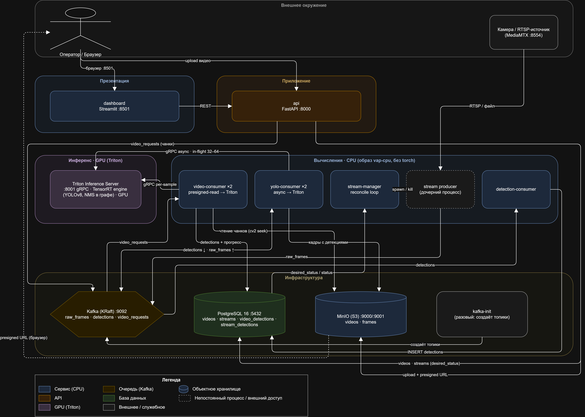
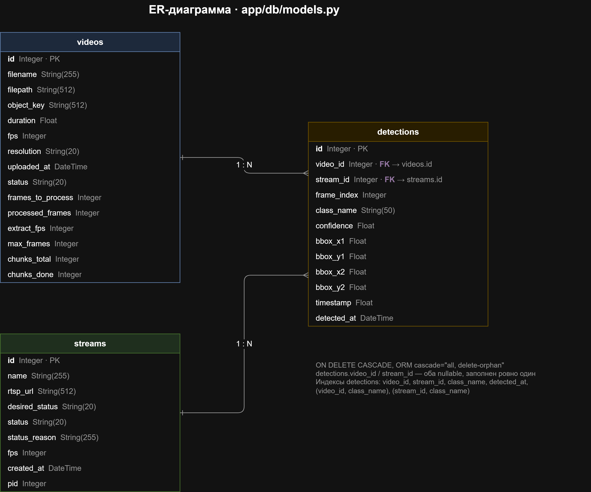
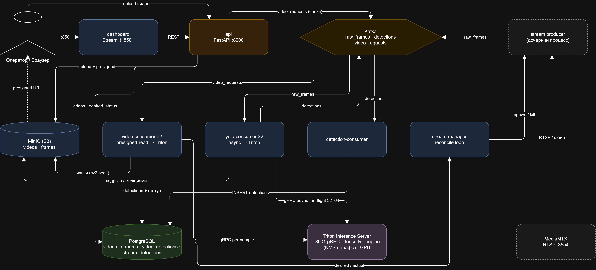

# Vision Analytics Platform — Архитектура

## Цель

Система обнаружения объектов (YOLO) для:
- **Загружаемых видеофайлов** (MP4, AVI, MOV, MKV)
- **RTSP/IP стримов** в реальном времени

---

## Обзор архитектуры



### 1. Точка входа — `app/main.py`

```python
FastAPI приложение с роутерами:
├── /api/videos      # CRUD для видеофайлов
├── /api/streams     # Управление RTSP стримами
└── /api/analytics   # Агрегированная статистика
```

События жизненного цикла (lifespan):
- `init_db()` — создать таблицы, если отсутствуют (не критично; предпочтителен Alembic)
- `storage.ensure_bucket()` — создать бакет MinIO
- `storage.set_stream_frames_ttl(days=7)` — автоудаление кадров стримов старше 7 дней

---

### 2. Загрузка видео — `POST /api/videos/upload`

```
Клиент (браузер / дашборд)
    |
FastAPI: upload_video()
    |
1. Создаётся запись Video в БД (статус: "processing")
2. Файл сохраняется во временную папку -> загружается в MinIO через fput_object (multipart)
3. Временный файл удаляется
4. План диспетчеризации (app/processing/planner.py): короткое видео
   (< video_min_chunk_duration) -> одна задача {"video_id": id};
   длинное -> пакет чанков {"video_id", "start_s", "end_s"} по
   video_chunk_sec секунд, разложенный ротацией по 8 партициям
   топика video_requests
5. Возврат 201 мгновенно (клиент опрашивает /api/videos/{id}/status)
```

---

### 3. Обработка видео (video_consumer)

```
VideoConsumer: читает video_requests
    |
    +-- {"video_id"}                    -> process_video()  — весь файл одним проходом
    +-- {"video_id","start_s","end_s"}  -> process_video_chunk() — срез [start_s, end_s)
    |
app.processing.processor
    |
- Читает видео НАПРЯМУЮ из MinIO по HTTP (OpenCV + FFmpeg streaming)
- НЕ скачивает на диск
    |
- Чанкование длинных видео: чанки одного видео распределяются по
  партициям и обрабатываются ПАРАЛЛЕЛЬНО разными репликами
  video-consumer (roundrobin assignment, без key у сообщения —
  key приковал бы все чанки к одной партиции/реплике)
- Владение кадрами — по ВРЕМЕННОЙ сетке: чанк отвечает за отметки
  k/extract_fps в своём диапазоне; сэмпл отметки — первый декодированный
  кадр с t >= отметки (иммунитет к VFR; индексная сетка на VFR ломается)
- Детекция каждого N-го кадра через Triton (управляется settings.extract_fps)
    |
- Создаются записи Detection в БД:
  frame_index, timestamp, class_name, bbox, confidence
    |
- Прогресс и финализация — атомарные SQL-инкременты (processed_frames,
  chunks_done): реплики пишут конкурентно; кто довёл chunks_done до
  chunks_total — ставит терминальный статус
- Video.status = "completed" | "partial" | "failed"
- Обновляются Video.duration, Video.fps
```

Примечание: файл видео уже находится в MinIO со шага 2. Процессор НЕ
пере-загружает его. Он читает через presigned URL.

Гарантии доставки — at-least-once: консьюмер коммитит offset Kafka только
после обработки, поэтому падение процесса посреди видео приводит к повторной
доставке задачи. Идемпотентность: process_video() удаляет детекции видео
целиком, process_video_chunk() — только в СОБСТВЕННОМ диапазоне
[start_s, end_s), поэтому redelivery чанка не плодит дубли. Перманентные
ошибки помечаются в БД как `failed`, и offset коммитится —
битый файл не может заклинить очередь. Липкая CUDA-ошибка — выход БЕЗ коммита:
контейнер рестартует, задача повторится в свежем контексте.

---

### 4. Стримы (Kafka Pipeline)

```
RTSP URL -> app.streams.producer.FrameProducer (subprocess, запускается stream_manager)
    |
Читает RTSP через OpenCV.VideoCapture (принудительный TCP-транспорт в Docker)
    |
Отбор кадров по НАСТОЯЩЕМУ ВРЕМЕНИ (каждый кадр декодируется — GOP
нельзя раскодировать с пропуском, а JPEG пишется только отобранному кадру):
  - Кодирование в JPEG (q80), публикация бинарным конвертом (метаданные + JPEG)
  - Публикация в Kafka топик "raw_frames" (6 партиций, без ключа — ровная раздача)
        |
        +--> app.consumers.yolo_frames.YOLOConsumer (x3)
        |      - JPEG-intake: байты кадра уходят в DALI-ансамбль yolo_jpeg
        |        (декод nvImageCodec + resize/letterbox на GPU Triton'а) —
        |        клиентский imdecode не нужен; запросы выравниваются по
        |        бакету TRITON_JPEG_PAD, иначе динамический батчинг не склеивает
        |      - async-поток одиночных запросов, окно in-flight YOLO_INFER_WINDOW
        |      - Сохраняет кадры С детекциями в MinIO: streams/{stream_id}/{index}.jpg
        |      - Публикует детекции в Kafka топик "detections" (ключ = stream_id)
        |
        +--> (второй consumer на raw_frames отсутствует)

Kafka топик "detections" (6 партиций, ключ stream_id — весь стрим у одного
владельца, потому что трекер живёт в памяти консьюмера)
        |
        +--> app.consumers.detections.DetectionConsumer (x3)
               - Читает детекции батчем (bulk-транзакция вместо построчной)
               - Трекает объекты ByteTrack'ом (app/tracking): двухстадийная
                 ассоциация IoU поверх Kalman-предсказания, стабильный track_id
                 через гэпы детекций и окклюзии
               - Записывает строки Detection (с track_id) и жизненный цикл
                 треков (tracks: opened/touched/closed) в PostgreSQL
```

Жизненный цикл стрима (паттерн desired-state + reconciler):
1. `POST /api/streams` — создать запись Stream (`desired_status`: inactive)
2. `POST /api/streams/{id}/start` — записать `desired_status=active` (API НИЧЕГО не спавнит)
3. `POST /api/streams/{id}/stop` — записать `desired_status=inactive`
4. `DELETE /api/streams/{id}` — удалить запись + удалить кадры из MinIO
   (зачистка бакета идёт фоном: DELETE отвечает за десятки миллисекунд)

API — только «заказчик»: пишет намерение (`desired_status`) в БД. Реальными
процессами producer'а владеет отдельный сервис `stream_manager`
(`app/streams/manager.py`) — см. § «Stream supervision» ниже.

Нумерация кадров (`frame_index`) сквозная: при старте producer продолжает
счёт от `max(frame_index)` из БД (`FrameProducer._initial_frame_index()`).
Без этого рестарт стрима обнулял счётчик, новые кадры перезаписывали старые
ключи `streams/{id}/{index}.jpg`, и `/latest-frame` (берёт `max()` по ключам)
навсегда залипал на старом максимуме — превью «стояло на одном кадре».

### Stream supervision (desired-state + reconciler)

Раньше API сам спавнил producer'а и держал живые `Popen` в словаре в памяти
(`_running_processes`). Отсюда три бага: рестарт API убивал все стримы,
упавший producer не поднимался, а два экземпляра API дрались за один стрим.

Теперь разделили НАМЕРЕНИЕ и ФАКТ (как контроллеры Kubernetes):
- `Stream.desired_status` (active/inactive) — намерение, пишет только API;
- `Stream.status` (starting/active/inactive/error) — факт, пишет только `stream_manager`;
- `Stream.status_reason` — диагноз при `status=error`.

`stream_manager` крутит reconcile loop: каждый виток читает desired из БД,
сравнивает со своими живыми дочерними процессами и сближает их — недостающих
поднимает, лишних убивает. Виток идемпотентен (живых не трогает), поэтому
рестарт API безразличен стримам, а упавший producer поднимается сам.

Статус честный: при спавне ставится `starting` (процесс запущен, но источник
ещё не подтверждён), а `active` — только когда producer пережил `HEALTHY_THRESHOLD`
(30с). Так недоступный источник не светится зелёным.

Backoff от spawn-шторма: смерть считается крашем, если producer завершился с
кодом `EXIT_OPEN_FAILED` (42 — «источник не открылся», независимо от времени
жизни) либо прожил меньше `HEALTHY_THRESHOLD`. После `MAX_FAST_CRASHES` (3)
крашей подряд стрим получает `status=error` с причиной и больше не поднимается,
пока пользователь не сделает `stop` → `start` (это снимает стрим с desired и
очищает состояние). Порог заведомо больше времени открытия RTSP (~несколько
секунд), иначе битый источник, падающий на ~10с, бесконечно переподнимался.

---

### 5. Хранилище — `app/core/storage.py` (MinIO / S3)

| Префикс | Содержимое | TTL |
|---------|-----------|-----|
| `videos/{id}.{ext}` | Исходные загруженные видео | Отсутствует (управляется пользователем) |
| `streams/{id}/{frame}.jpg` | Кадры стримов с детекциями | 7 дней (lifecycle rule) |

Все параметры берутся из `app.core.config.settings` (переменные окружения / `.env`).

#### Presigned URL: внутренний и публичный endpoint

У presigned ссылок два потребителя с разной сетевой видимостью:

| Потребитель | Endpoint | Пример |
|-------------|----------|--------|
| Серверная часть (cv2-seek в api, дашборд из контейнера) | `S3_ENDPOINT` | `http://minio:9000/...` |
| Браузер (видео-плеер дашборда) | `S3_PUBLIC_ENDPOINT` | `http://localhost:9000/...` |

Браузер не резолвит docker-имена (`minio:9000`), поэтому ссылки для него
подписываются отдельным Minio-клиентом на публичном адресе. Хост участвует в
подписи SigV4 — подменить его в готовой ссылке нельзя, только подписать
заранее. Region задаётся явно (`us-east-1`): иначе minio-py перед presign'ом
ходит на `GetBucketLocation` к своему endpoint — а до `localhost:9000` из
контейнера доступа нет.

---

### 6. Аналитика — `app/api/routes/analytics.py`

| Эндпоинт | Описание |
|----------|----------|
| `GET /api/analytics/stats` | Общее число видео, детекций, средняя уверенность |
| `GET /api/analytics/class-distribution` | Данные для круговой диаграммы: количество по классам |
| `GET /api/analytics/timeline` | Детекции по времени (бакеты по секундам) |
| `GET /api/analytics/stream-activity` | Детекции в минуту для стримов |

Все поддерживают фильтр `source=video|stream` и фильтры `video_id` / `stream_id`.

---

### 7. Дашборд — `dashboard/app.py` (Streamlit)

- **Страница "Видео"**: форма загрузки, список видео, круговая диаграмма классов,
  столбчатый график по времени + **синхронный двойной плеер**: два окна
  (чистое видео / те же кадры с боксами) на одном общем таймлайне.
  Реализован JS-компонентом (`streamlit.components.v1.html`,
  `SYNC_PLAYER_TEMPLATE`): все детекции видео инжектятся в HTML как JSON,
  ближайший обработанный кадр ищётся бинарным поиском по `currentTime`,
  боксы рисуются на canvas-оверлее. Синхронизация плееров клиентская —
  Streamlit не может дёргать сервер на каждый кадр.
- **Страница "Стримы"**: добавление/запуск/остановка/удаление RTSP, live-превью
  (поллинг `/latest-frame` с настраиваемым интервалом 2–10 с), график активности,
  последние детекции, галерея кропов объектов и **панель треков** (кто в кадре,
  сколько пробыл, статус active/closed — из `/api/streams/{id}/tracks`).
- Запросы к API кэшируются с TTL 10 сек (`@st.cache_data`)
- Автообновление страницы стримов: `st.rerun()` — строго в конце страницы
  (rerun обрывает выполнение скрипта, и секции ниже него не отрисовываются)

---

## Модель данных

Четыре таблицы PostgreSQL (`app/db/models.py`), версии накатываются Alembic.



### `videos`
| Колонка | Тип | Примечание |
|---------|-----|-----------|
| `id` | int PK | |
| `filename` | varchar(255) | |
| `filepath` | varchar(512) | локальный путь (опц.) |
| `object_key` | varchar(512) | ключ в MinIO, напр. `videos/5.mp4` |
| `duration` | float | секунды |
| `fps` | int | |
| `resolution` | varchar(20) | напр. `1920x1080` |
| `uploaded_at` | datetime | server default `now()` |
| `status` | varchar(20) | `processing` → `completed` / `partial` / `failed` |

### `video_detections`
Детекции загруженных видео. Отделены от стримовых: жизненный цикл привязан
к файлу (умирают вместе с видео каскадом), система времени — секунда от начала файла.

| Колонка | Тип | Примечание |
|---------|-----|-----------|
| `id` | int PK | |
| `video_id` | int FK → `videos.id` | NOT NULL, `ON DELETE CASCADE` |
| `frame_index` | int | ключ кадра в MinIO |
| `class_name` | varchar(50) | |
| `confidence` | float | |
| `bbox_x1/y1/x2/y2` | float | ограничивающий бокс |
| `timestamp` | float | секунда внутри видеофайла |
| `detected_at` | datetime | реальное время детекции |

Индексы: `(video_id, class_name)`, `(video_id, timestamp)`.

### `stream_detections`
Детекции RTSP-стримов. Копятся бесконечно (камера — постоянный объект),
поэтому retention планируется по возрасту (`detected_at`), а не по жизни источника.

| Колонка | Тип | Примечание |
|---------|-----|-----------|
| `id` | int PK | |
| `stream_id` | int FK → `streams.id` | NOT NULL, `ON DELETE CASCADE` |
| `frame_index` | int | ключ кадра в MinIO |
| `class_name` | varchar(50) | |
| `confidence` | float | |
| `bbox_x1/y1/x2/y2` | float | ограничивающий бокс |
| `detected_at` | datetime | реальное время детекции |
| `track_id` | int FK → `tracks.id` | трек детекции (NULL до трекинга); `ON DELETE SET NULL` — детекции переживают закрытие трека |

Индексы: `(stream_id, class_name)`, `(stream_id, detected_at)`.

Раньше это была одна таблица `detections` с nullable-парой FK
(`video_id` XOR `stream_id`); разделение сделало инвариант «ровно один
владелец» частью схемы (NOT NULL FK) и развело retention-планы.

### `tracks`
Жизненный цикл отслеженного объекта стрима (ByteTrack, `app/tracking`).
Строка открывается при подтверждении трека (`track_min_hits` попаданий),
обновляется на каждом кадре с объектом и закрывается при потере (объект не
подтверждался дольше `track_max_age_sec`, отсчитанных в кадрах подачи) или при
рестарте консьюмера (состояние трекеров живёт в памяти). Фундамент для
будущих зон/dwell-time: «кто, где и сколько пробыл» читается отсюда без
перегруппировки сырых детекций.

| Колонка | Тип | Примечание |
|---------|-----|-----------|
| `id` | int PK | на него ссылается `stream_detections.track_id` |
| `stream_id` | int FK → `streams.id` | NOT NULL, `ON DELETE CASCADE` |
| `class_name` | varchar(50) | |
| `status` | varchar(20) | `active` / `closed` |
| `closed_reason` | varchar(20) | `lost` (объект пропал) / `restart` (состояние трекера потеряно) |
| `first_seen_at` / `last_seen_at` / `closed_at` | datetime | границы жизни |
| `first_frame_index` / `last_frame_index` | int | |
| `num_frames` | int | кадров ПОДТВЕРЖДЁН (не по предсказанию KF) |
| `bbox_x1/y1/x2/y2` | float | последний наблюдённый бокс (отладка/дашборд без join) |

Индексы: `(stream_id, status)`, `(stream_id, last_seen_at)`.

### `streams`
| Колонка | Тип | Примечание |
|---------|-----|-----------|
| `id` | int PK | |
| `name` | varchar(255) | |
| `rtsp_url` | varchar(512) | |
| `desired_status` | varchar(20) | **намерение** — `active`/`inactive`; пишет только API |
| `status` | varchar(20) | **факт** — `starting`/`active`/`inactive`/`error`; пишет только `stream_manager` |
| `status_reason` | varchar(255) | диагноз при `status=error` |
| `fps` | int | частота захвата |
| `created_at` | datetime | server default `now()` |
| `pid` | int | легаси — pid producer'а; больше не поддерживается (см. § Stream supervision) |

Разделение `desired_status` (намерение) vs `status` (факт) — ядро паттерна
desired-state + reconciler: намерением владеет API, наблюдаемым фактом —
`stream_manager`. Оба поля лежат в БД, поэтому переживают рестарт и API, и менеджера.

---

## Структура проекта

Пакеты повторяют рантайм-юниты: один compose-сервис = один пакет-точка
входа; общий код живёт в `core/`, `db/`, `schemas/`.

```
app/
├── main.py                     # FastAPI приложение, lifespan, регистрация роутеров
├── core/                       # общее ядро
│   ├── config.py               # pydantic-settings: БД, Kafka, S3, Triton
│   ├── cuda.py                 # классификация липких CUDA-ошибок (консьюмеры)
│   ├── database.py             # SQLAlchemy engine, SessionLocal, Base, get_db
│   ├── storage.py              # MinIO клиент: upload, download, presigned, TTL
│   ├── metrics.py              # Prometheus-метрики, helpers, start_metrics_server
│   └── topics.py               # Имена Kafka топиков, bootstrap серверы
├── db/
│   └── models.py               # SQLAlchemy: Video, Detection, Stream, Track
├── api/                        # compose-сервис: api
│   └── routes/
│       ├── videos.py           # CRUD: upload, list, get, status, frame, delete
│       ├── streams.py          # CRUD: create, start, stop, delete, detections, frames
│       └── analytics.py        # stats, class-distribution, timeline, stream-activity
├── schemas/
│   ├── video.py                # VideoBase, VideoCreate, VideoRead (Pydantic v2)
│   └── detection.py            # DetectionBase, DetectionRead
├── processing/                 # домен обработки видео (используется consumers/video)
│   ├── processor.py            # process_video(): чтение из MinIO -> Triton -> БД
│   ├── triton_detector.py      # TritonDetector: gRPC-клиент Triton (TensorRT engine)
│   └── extractor.py            # VideoCapture context manager, Frame dataclass
├── streams/                    # compose-сервис: stream-manager
│   ├── manager.py              # reconciler: desired-state цикл над producer'ами
│   └── producer.py             # FrameProducer: RTSP/файл -> Kafka raw_frames
├── tracking/                   # ByteTrack (живёт в detection-консьюмере)
│   ├── byte_tracker.py         # двухстадийная ассоциация high/low, рождение/смерть
│   ├── kalman.py               # KalmanBox: constant-velocity предсказание бокса
│   ├── association.py          # IoU-матрица + венгерский алгоритм (scipy)
│   └── registry.py             # трекер на стрим, бюджет кадров от fps потока
└── consumers/                  # Kafka-консьюмеры (модуль = контейнер)
    ├── video.py                # VideoConsumer: video_requests -> process_video -> БД
    ├── yolo_frames.py          # raw_frames -> Triton (JPEG-intake) -> detections + MinIO
    └── detections.py           # DetectionConsumer: detections -> ByteTrack -> PostgreSQL

alembic/                        # Миграции БД (alembic upgrade head)
tests/                          # pytest: API, TritonDetector, extractor, streams, консьюмеры
dashboard/                      # Streamlit приложение
monitoring/                     # observability как код
├── prometheus/prometheus.yml   #   таргеты; video- и detection-consumer — dns_sd per-replica
└── grafana/provisioning/       #   datasource + дашборды JSON (правка = коммит)
.github/workflows/              # CI (lint + test), Docker build
docker-compose.yml              # Все сервисы, включая triton (GPU-резерв у него)
Dockerfile.cpu                  # Единый образ (api, консьюмеры, dashboard; без torch)
Makefile                        # make up / make down / make test / make lint
pyproject.toml                  # Конфигурация pytest, ruff, alembic
pyproject.toml                  # Зависимости (PEP 621): база + extras triton/dash/dev;
                                #   образ: ".[dash,triton]", CI: ".[triton,dev]",
                                #   локалка: -e ".[dash,triton,dev]"
```

---

## Поток данных



### Путь А: Загружаемое видео

```
Клиент -> POST /api/videos/upload
    |
    v
FastAPI: создать запись Video -> загрузить файл в MinIO -> опубликовать
задачу (или пакет чанков) в Kafka "video_requests"
    |
    v
VideoConsumer (x replicas): process_video() / process_video_chunk()
    |  читает видео из MinIO по HTTP (presigned URL)
    |  чанки одного видео жуются репликами ПАРАЛЛЕЛЬНО (time-grid владение)
    |  Детекция каждого N-го кадра (Triton)
    |  запись строк Detection в PostgreSQL
    |  атомарные инкременты прогресса, финализация по chunks_done
    v
Клиент опрашивает GET /api/videos/{id}/status -> "completed"
```

### Путь Б: RTSP стрим

```
1. POST /api/streams           -> создать запись Stream (desired inactive)
2. POST /api/streams/{id}/start -> desired_status=active; stream_manager поднимет subprocess
    |
    v
FrameProducer: читает RTSP -> кодирует JPEG -> публикует в Kafka "raw_frames"
    |
    v
YOLOConsumer: потребляет "raw_frames" -> JPEG в DALI-ансамбль Triton'а
    |                                  -> публикует "detections" (ключ stream_id)
    |                                  -> сохраняет кадр в MinIO (если есть детекции)
    v
DetectionConsumer: потребляет "detections" -> ByteTrack (стабильный track_id)
    |                    -> строки Detection + жизненный цикл tracks в PostgreSQL
    v
Дашборд: GET /api/streams/{id}/detections + /tracks + /api/analytics/stream-activity
```

---

## Ключевые технологии

| Слой | Технология |
|------|-----------|
| API | FastAPI (Python 3.12) |
| База данных | PostgreSQL 16 (SQLAlchemy ORM) |
| Миграции | Alembic |
| Объектное хранилище | MinIO (S3-совместимое) |
| Очереди | Kafka (режим KRaft, без ZooKeeper) — события и задачи обработки видео |
| ML | YOLOv8 на Triton Inference Server (TensorRT engine, NMS в графе, DALI JPEG-intake) |
| Трекинг | ByteTrack (двухстадийная IoU-ассоциация поверх Kalman-предсказания, scipy) |
| Медиа | OpenCV + FFmpeg |
| Дашборд | Streamlit + Plotly |
| Мониторинг | Prometheus + Grafana + kafka-exporter |
| Линтинг | Ruff |
| CI | GitHub Actions |

---

## Docker архитектура

Один образ: torch в проекте не используется вовсе, инференс вынесен в
Triton Inference Server (TensorRT engine, единственный бэкенд детекции).

| Образ | Dockerfile | Сервисы | Содержимое |
|-------|-----------|---------|-----------|
| `vap-cpu` | `Dockerfile.cpu` | api, video-consumer, yolo-consumer, detection-consumer, stream-manager, dashboard | Без torch (~2 ГБ) |

Сервисы в `docker-compose.yml`:

| Сервис | Образ | Порт | Назначение |
|--------|-------|------|-----------|
| `db` | postgres:16-alpine | 5432 | База данных |
| `api` | vap-cpu | 8000 | FastAPI сервер |
| `dashboard` | vap-cpu | 8501 | Streamlit дашборд |
| `kafka` | cp-kafka:7.6.0 | 9092 | Kafka брокер (KRaft) |
| `kafka-init` | cp-kafka:7.6.0 | — | Одноразовый: создание топиков |
| `triton` | nvcr.io/nvidia/tritonserver | 8001 (gRPC), 8002 (метрики) | Инференс YOLOv8 (TensorRT), GPU-резерв |
| `video-consumer` | vap-cpu | — | video_requests -> process_video -> БД (replicas: 2) |
| `yolo-consumer` | vap-cpu | — | Kafka -> Triton (JPEG-intake) -> детекции (replicas: 3, потолок GIL ~110 msg/s на реплику) |
| `detection-consumer` | vap-cpu | — | Kafka -> ByteTrack -> PostgreSQL (replicas: 3; партиции detections ключены stream_id, стрим целиком у одного владельца) |
| `stream-manager` | vap-cpu | — | Reconciler: владеет процессами producer'ов |
| `mediamtx` | bluenviron/mediamtx | 8554 | RTSP сервер (симуляция камеры) |
| `minio` | minio/minio | 9000, 9001 | Объектное хранилище + веб-консоль |
| `prometheus` | prom/prometheus | 9090 | Сбор метрик (pull, 15с), retention 7d |
| `kafka-exporter` | danielqsj/kafka-exporter | 9308 | Лаги консьюмер-групп и размеры топиков |
| `grafana` | grafana/grafana | 3000 | Дашборды (provisioning из monitoring/) |

GPU нужен одному сервису — `triton`: его резервирование описано прямо в
базовом `docker-compose.yml` (override-файлы больше не нужны). Engine
(`models/triton/yolo_detector/1/model.plan`) собирается во внешней репе
`yolo-trt-nms` и в git не попадает — тег образа Triton обязан совпадать с
версией TensorRT, под которую собран engine.

Консьюмеры GPU-контекст не создают вовсе (инференс по gRPC), поэтому
`fork()`-проблематика ушла; параллелизм — `deploy.replicas: 2`
(независимые контейнеры, Kafka раздаёт партиции `video_requests` между ними).

---

## Мониторинг

Модель pull: каждый сервис сам отдаёт `GET /metrics` (prometheus_client),
Prometheus скрейпит каждые 15с, Grafana рендерит PromQL. Конфиги — код в
`monitoring/` (provisioning перезагружает дашборды за ~30с).

| Экспортер | Порт | Что меряет |
|-----------|------|-----------|
| api | 8000 | HTTP-запросы/latency (prometheus-fastapi-instrumentator) |
| yolo-consumer | 9091 | кадры: decode/inference/queue wait по `raw_frames`, poison |
| detection-consumer | 9092 | запись детекций, очередь detections, трекинг |
| video-consumer | 9093 | трасса задачи: queue wait (от `enqueued_at` API), задача целиком, этапы чанка decode/inference/write (бакеты до 600с) |
| kafka-exporter | 9308 | лаги групп, размеры топиков (считает брокер — всегда честно) |

Дашборды: Pipeline Overview (здоровье), Streams Trace (+`stream_id`),
Video Track (полная трасса + «накладные расходы» как регресс-гард тяжёлой
инициализации), Infra (Kafka/API/процессы).

**Per-replica скрейпинг.** `video-consumer` и `detection-consumer` в 2+ репликах:
одно DNS-имя резолвится round-robin, и один static-таргет чередовал бы счётчики
реплик в одной серии (13/16/13/16) — Prometheus счёл бы каждый перепад сбросом
счётчика, `rate()`/`increase()`/квантили нафантазировали бы задач в разы больше
реальных. Лечится `dns_sd_configs type=A`: Docker DNS отдаёт все IP реплик по
имени сервиса, Prometheus создаёт таргет на каждый. Дашборды агрегируют `sum()`
/ `sum by (le)` — суммарные графики остаются суммарными.
(`tasks.<service>` для этого не нужен — это Swarm; в Compose хватает имени.)

**Как читать квантили.** `rate(...[15m])` — скользящее окно: при простое
линии затухают (память о последних задачах), а на редких данных квантиль
шумит. Панель «Полная трасса» рисует объём окна (столбцы, правая ось):
мало наблюдений — квантилю не верим.

---

## Детали реализации

### Почему читаем видео из MinIO по HTTP?
- Консьюмеры работают в отдельных контейнерах — общая файловая система недоступна
- OpenCV (backend FFmpeg) поддерживает источники `http://` нативно
- Избегает скачивания 7 ГБ файлов на диск консьюмера

### Почему сохраняем только кадры стримов с детекциями?
- Стримы эфемерны — пустые кадры не имеют ценности
- 1 стрим ≈ 24 ГБ/день при 5 FPS; фильтрация экономит ~80% хранилища
- Lifecycle rule автоматически удаляет кадры старше 7 дней

### Почему JPEG-intake (DALI-ансамбль) вместо клиентского декода?
- yolo-consumer жал CPU на imdecode+letterbox каждого кадра; при JPEG-intake
  консьюмер шлёт в Triton сырые JPEG-байты, а декод (nvImageCodec), resize и
  letterbox считает GPU на ступени `dali_letterbox` ансамбля `yolo_jpeg`
- Экономия двойная: CPU консьюмера освобождается, а gRPC-запрос ~100 КБ
  вместо 1.23 МБ сырого тензора — сетевой путь перестает быть узким местом
- Динамический батчинг Triton'а склеивает только одинаковые шейпы входа, а
  длина JPEG у кадров разная — запросы выравниваются по бакету
  `TRITON_JPEG_PAD` (64 КБ): до выравнивания батч ступени DALI был 1.04
  (242 fps), после — 15.9 (424 fps). Декодер останавливается на EOI-маркере,
  нулевой хвост безразличен
- Дрейф против клиентского cv2-пути измерен `drift_check.py`: matched@0.5
  0.908, IoU 0.962 — в пределах порога 0.90
- Видео-трасса (processor.py) остаётся на `yolo_detector`: там кадры из
  cv2-декода, кодировать их в JPEG ради ансамбля — терять качество и CPU

### Почему трекинг в detection-консьюмере, а не в yolo?
- Трекеру нужны только JSON детекций — тяжёлая часть (инференс) не трогается,
  потолок yolo-consumer/Triton не страдает
- Состояние трекера — в памяти, поэтому партиции `detections` ключены
  `stream_id`: весь стрим целиком достаётся одной реплике, порядок внутри
  стрима сохраняется, один объект не получает несколько track_id
- TTL потерянного трека считается КАДРАМИ подачи, а не секундами: пауза
  источника или инференса трек не убивает, бюджет сам масштабируется fps'ом
  потока (`registry._budget_frames`)
- Строка `tracks` открывается на ПОДТВЕРЖДЕНИИ трека (`min_hits`), а не на
  рождении: тихая смерть одиночного фантома детектора не оставляла бы в БД
  вечно «active»-строк

### Почему producer'ами владеет отдельный stream_manager (reconciler)?
- Producer — это бесконечный блокирующий цикл (читает RTSP постоянно), не может
  работать внутри async event loop FastAPI → отдельный процесс
- Владелец процессов вынесен из API: рестарт/масштабирование API не роняет и не
  дублирует стримы (раньше `Popen` жили в памяти api и умирали вместе с ним)
- Один владелец = одна истина: два экземпляра API не дерутся за один стрим
- reconcile loop поднимает упавшего producer'а сам; backoff (см. § Stream
  supervision) не даёт устроить spawn-шторм на битом RTSP URL
- Логи producer'а теперь в `docker compose logs stream-manager` (там, где
  владелец процесса), а не в логах api

### Почему producer продолжает frame_index из БД?
- `frame_index` — это ключ кадра в MinIO (`streams/{id}/{index}.jpg`),
  а `/latest-frame` выбирает последний кадр как `max()` по этим ключам
- Обнуление счётчика при рестарте стрима заставляло новые кадры перезаписывать
  старые ключи: `max()` залипал на значении первого запуска, превью в дашборде
  «стояло на одном кадре», хотя детекции в БД продолжали капать
- Старт с `max(frame_index)` из БД безопасен: кадры сохраняются только при
  наличии детекций, поэтому на каждый сохранённый кадр есть строка Detection

### Почему превью видео — JS-компонент, а не st.video + st.slider?
- Нужны ДВА синхронных плеера (чистый / с боксами) на одном таймлайне —
  Streamlit-виджеты общаются с сервером через rerun, на каждый кадр таймлайна
  это неприемлемая задержка
- Боксы рисуются canvas-оверлеем поверх второго плеера по `currentTime`
  из уже инжектнутого JSON — ноль запросов к серверу во время воспроизведения
- Синхронизация правого («ведомого») плеера — drift-коррекция раз в 0.5 с

### Примечания по производительности
- gRPC-клиент Triton создаётся **один на процесс** консьюмера (ленивый кэш в
  `processor._get_detector()`): конструктор проверяет готовность модели и
  поднимает каналы; задач (чанков) за жизнь процесса проходят десятки.
  Сама модель в VRAM живёт на стороне Triton-сервера — консьюмеру она
  не нужна вовсе.
- Стримовый инференс — поток одиночных async-запросов: клиентские батчи
  синхронными запросами дали ~61 fps против ~156-210 fps у async-потока,
  потому что динамический батчинг склеивает прогоны движка сам
  (подробности и замеры — в докстринге `app/consumers/yolo_frames.py`)
- Окно in-flight `YOLO_INFER_WINDOW=64` на реплику: 3 реплики × 128
  пересыщали очередь DALI (Little's law) и роняли латентность на 300 fps;
  с 64 движок успевает склеивать батч 16 (макс engine), а очередь стоит
- Замер потолка (бенч 2026-11-13, RTX 5080 / 28 ядер Docker Desktop):
  устойчиво 240 msg/s, предельная мощность ~340 msg/s при e2e p95 0.84 с;
  стена — CPU-голодание Triton'а (живой сервис 350 req/s против 460–490
  в холостом замере), не GPU
- Kafka `message.max.bytes`: 5 МБ (JPEG кадры в бинарном конверте)
- Kafka retention: `raw_frames` = 1 час, `detections` = 24 часа, `video_requests` = 24 часа
- MinIO upload: `fput_object` (multipart) для видео, `put_object` для кадров
- Autovacuum: `tracks` и `stream_detections` получают bulk UPDATE/INSERT каждым
  батчем — дефолтный порог (50 + 20% строк) пробивается на пустой таблице,
  и vacuum гонял по 148 раз за 19-минутный прогон (I/O-шторм на медленном
  диске Docker VM). Пороги подняты миграцией `b4d92c1f7a35`

---

## Примеры API

```bash
# Загрузить видео
curl -F "file=@video.mp4" http://localhost:8000/api/videos/upload

# Проверить статус обработки
curl http://localhost:8000/api/videos/1/status

# Создать стрим
curl -X POST http://localhost:8000/api/streams \
  -H "Content-Type: application/json" \
  -d '{"name":"Camera 1","rtsp_url":"rtsp://mediamtx:8554/mystream","fps":5}'

# Запустить стрим
curl -X POST http://localhost:8000/api/streams/1/start

# Треки стрима (ByteTrack)
curl http://localhost:8000/api/streams/1/tracks

# Получить аналитику
curl "http://localhost:8000/api/analytics/stats?source=video"
curl "http://localhost:8000/api/analytics/class-distribution?video_id=1"
```

---

## Чеклист при запуске

1. `cp .env.example .env` — задать учётные данные при необходимости
2. `docker compose up -d` (или `make up`; нужен NVIDIA GPU — сервис `triton`)
3. `alembic upgrade head` — выполнить миграции (или положиться на `init_db()` при старте)
4. Проверить работоспособность: `curl http://localhost:8000/health`
5. Открыть дашборд: http://localhost:8501
6. Открыть консоль MinIO: http://localhost:9001 (minioadmin / minioadmin123)
7. Открыть Grafana: http://localhost:3000 (дашборды в General) и Prometheus:
   http://localhost:9090/query → Targets — все должны быть `up`


Видео-плеер в дашборде ходит в MinIO напрямую из браузера — проверь, что
`S3_PUBLIC_ENDPOINT` (дефолт `http://localhost:9000`) доступен с машины,
с которой открываешь дашборд.

---

## Ключевые точки доступа

| Задача | Файл |
|--------|------|
| Точка входа приложения | `app/main.py` |
| Консьюмер задач видео | `app/consumers/video.py` |
| Детекция (Triton-клиент) | `app/processing/triton_detector.py` |
| Пайплайн видео | `app/processing/processor.py` |
| Хранилище MinIO | `app/core/storage.py` |
| Модели БД | `app/db/models.py` |
| Конфигурация / переменные окружения | `app/core/config.py` |
| Kafka топики | `app/core/topics.py` |
| Prometheus-метрики | `app/core/metrics.py` |
| Конфигурация мониторинга | `monitoring/` |
| Миграции БД | `alembic/versions/` |
```
